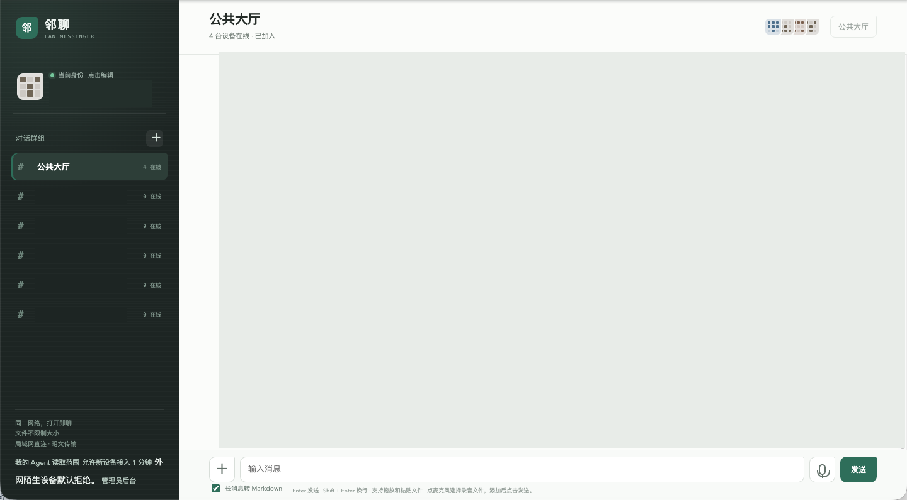
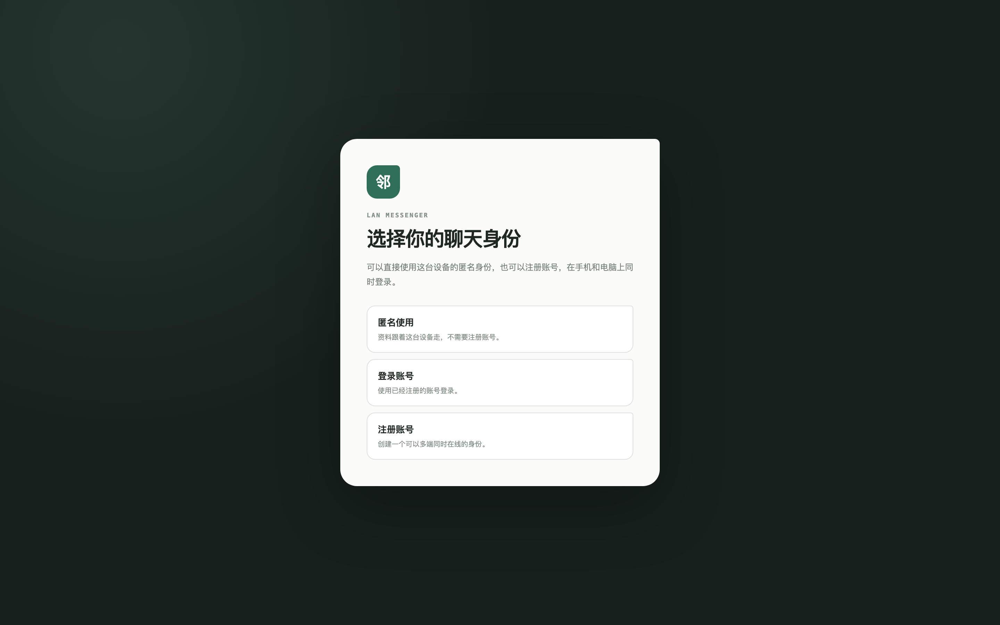
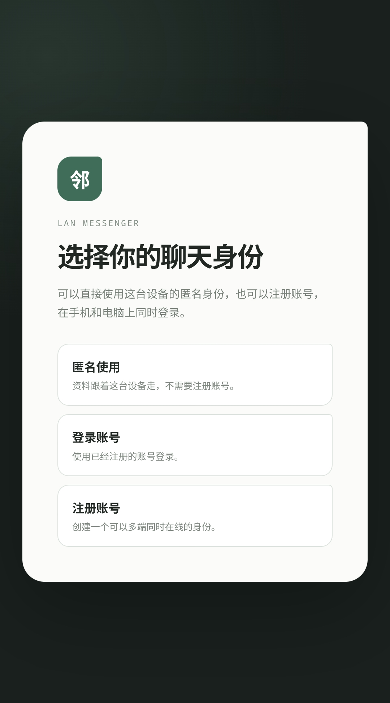
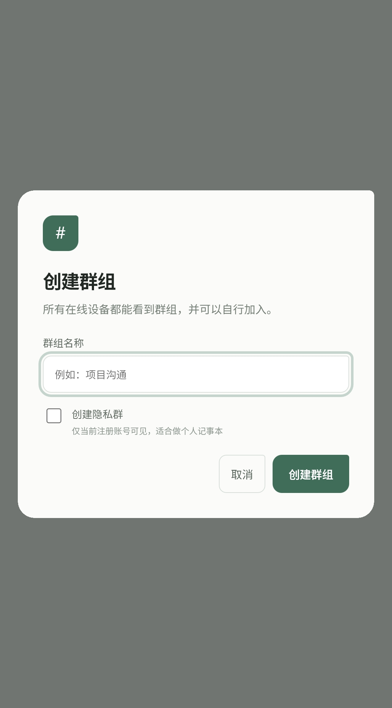
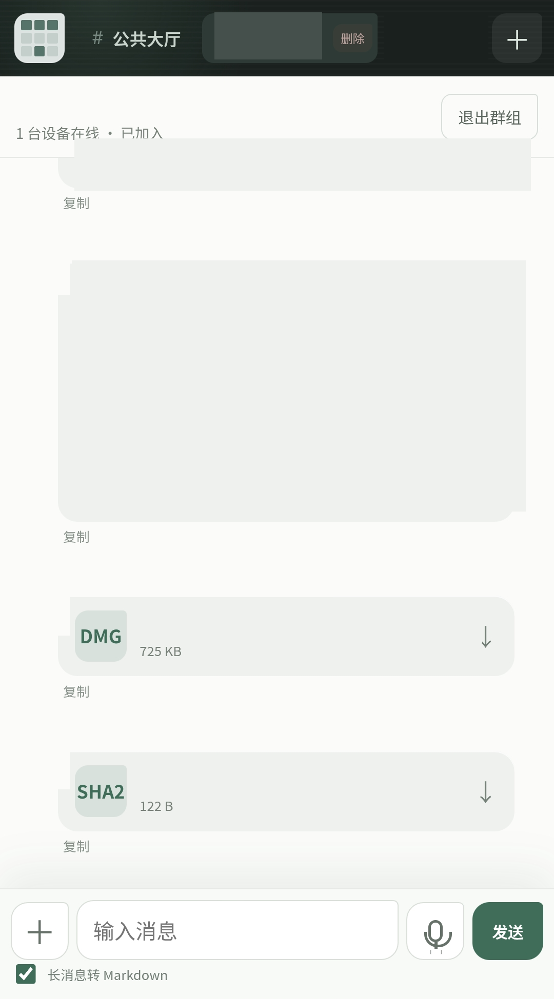
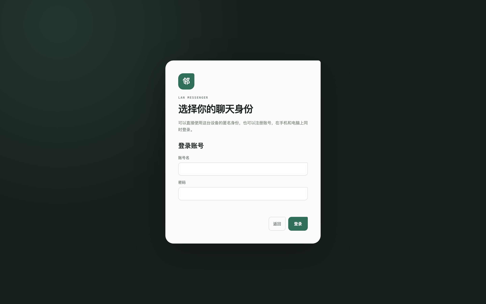
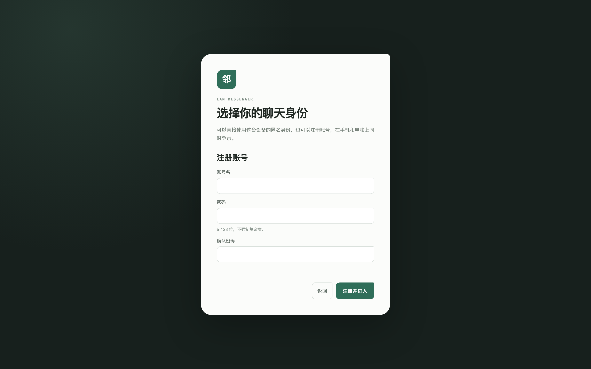
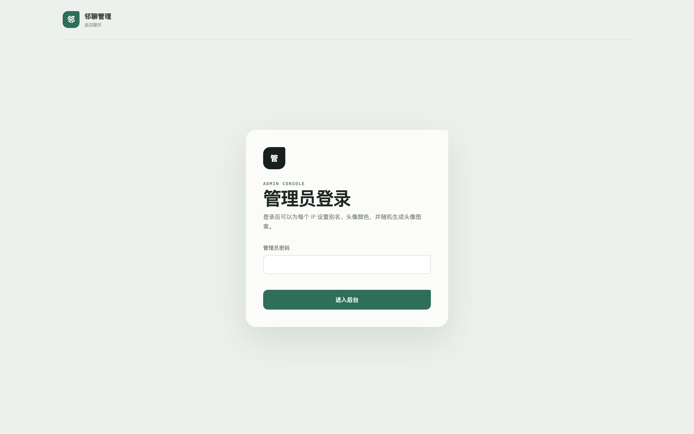

# 邻聊

在局域网里用浏览器收发文字、图片、语音条和文件的聊天服务。打开页面后可以选择匿名使用，也可以注册账号，在电脑和手机浏览器之间共用同一身份。

本说明对应网页服务 **2.5.1**。它不包含独立的手机应用，也不包含音视频通话。

## 适用场景

- 家庭、工作室或公司内网，希望不经过应用商店、用浏览器就能传文件和聊天。
- 一台已安装 Node.js 的电脑作为服务端，同一局域网里的电脑和手机直接访问。
- 若需要让外网也打开同一套页面或 MCP 入口，请使用你自己的域名，经 HTTPS 反向代理接入。完整步骤见 [docs/部署.md](docs/部署.md)。不要把未做认证的聊天端口直接映射到公网。

## 特色

- **一种服务，电脑和手机都能用。** 电脑浏览器走完整页面；手机浏览器使用顶部横向群组栏和触控优化的发送区，并对部分旧版 Android 浏览器做了视口和滚动兼容。
- **匿名或账号，随你选。** 匿名资料跟当前设备走；注册账号后，同一账号可以在多台设备同时在线，昵称和头像会同步。已经发出的消息会保留当时的昵称和头像，之后改资料不会改写历史记录。
- **文件按文件传。** 支持多选、拖放到窗口、从剪贴板粘贴，发送前可在队列里看到上传进度。默认不限制单文件大小，上传直接流式写入磁盘。普通文件走专用下载接口，支持中文文件名、强制保存和分段下载。
- **群组由成员自己管理。** 可以创建、加入、退出群组，也可以删除自己创建的群组。普通群组要先加入才能查看消息、附件和长文；注册账号还可以创建只对自己可见的隐私群，这些群不会出现在公共列表里。
- **给 Agent 留了正规入口。** 注册账号可以设置自己的 Agent 读取范围；管理员只配置普通群组的范围，并不靠后台直接阅读聊天内容。服务提供标准 JSON-RPC MCP 接口，供已授权的账号使用。隐私群、Agent 读取范围和管理后台登录后的页面目前没有配套截图，这些能力只在文字中说明。
- **有独立的管理后台。** 管理员使用密码登录，会话有时效。可以协助调整成员资料、查看设备接入情况，并通过接口撤回消息。发送者也可以撤回自己发出的消息。

## 界面

以下为 2.5.1 真实页面截图，已去除账号、地址和聊天内容。登录、注册和管理后台登录放在折叠块中。

公共大厅：群组列表、在线成员、文字与文件/语音发送区。截图中的消息区已清空。



打开站点后，可以选择匿名使用、登录账号或注册账号。





手机上同样可以创建群组，并在聊天里发送和下载文件。





<details>
<summary>登录、注册与管理后台登录</summary>







</details>

## 快速开始

需要 **Node.js 20 或更高版本**，以及 npm。`package.json` 的 `engines` 声明为 `>=20`，因为锁定的 `@httptoolkit/httpolyglot@3.1.0` 要求 Node.js 20 以上。`npm run dev` 使用 `node --watch`。

在项目目录中：

```bash
npm ci
PORT=9900 npm start
```

请显式加上 `PORT=9900`。若省略 `PORT`，程序入口会回退到 `3080`。

程序通过 `process.env` 读取配置，**不会自动读取 `.env` 文件**。仓库里的 [`.env.example`](.env.example) 只是示例。若把变量写在本地文件里，需要由 shell、systemd 或其他进程管理器在启动前注入。

健康检查：

```bash
curl http://127.0.0.1:9900/api/health
```

正常时应返回 JSON，并包含 `"ok": true` 以及 `"version": "2.5.1"`。

然后在本机浏览器打开：

- 聊天页面：http://127.0.0.1:9900/
- 管理后台：http://127.0.0.1:9900/admin
- 网页录音说明：http://127.0.0.1:9900/secure-setup.html

首次启动且未设置 `ADMIN_PASSWORD` 时，程序会生成随机管理员密码，明文写入数据目录中仅服务用户可读的 `admin-password.txt`，校验信息以 scrypt 哈希保存。请在本机读取该文件后登录后台，不要把该文件放进仓库。也可用环境变量 `ADMIN_PASSWORD` 覆盖。

从局域网其他设备访问时，把 `127.0.0.1` 换成这台主机的地址。服务监听所有地址上的指定端口，并不会自动只绑定回环地址；如果主机还能被局域网以外访问，请用防火墙限制来源。

`install.sh` 会把程序装到当前用户的 `~/services/lan-chat`，复制 `deploy/lan-chat.service`，并用当前 `PATH` 里的 `node` 改写服务的启动命令。它面向带有 systemd 用户实例的 Linux。没有 systemd 用户实例时，脚本会在完成复制、`npm ci` 和 `npm test` 后以非零状态退出，并提示改用 `PORT=9900 npm start`；这表示开机服务没有启用，不表示测试失败。本次发布验证就是这种结果，因此没有把“用户服务已启用”记为通过。已执行的检查见 [部署说明第 5 节](docs/部署.md)。

本地部署的完整步骤，以及外网接入时应用层与网络层如何配合，见 **[部署说明](docs/部署.md)**。

## 能做什么

- 文字、图片、普通文件和语音条
- 打开页面、加载历史或切换群组时，自动落到最新消息
- 浏览器只在安全上下文（本机 `localhost` / `127.0.0.1` 或 HTTPS）里允许网页直接使用麦克风；普通局域网 HTTP 下会改为选择已有录音文件再发送
- 账号名支持 3 到 32 个中文、字母、数字、下划线或短横线；密码长度为 6 到 128 位
- 可以退出账号或切换身份
- 长文字默认以 Markdown 卡片保存，需要时再点开查看或下载；完整文字仍保留在数据层，供已授权的 Agent 按需读取
- 同时监听 IPv4 和 IPv6（`server.listen(PORT, '::')`）
- 可选开启设备接入门禁。默认关闭，而且默认不信任任何网段；开启后必须自己配置内网网段、排除地址和允许的 Host

## 数据与安全（请先读）

默认数据目录位于程序运行目录下的 `data/`（也可用 `DATA_DIR` 指定）。其中包含明文保存的消息和撤回状态、群组、设备资料、账号资料，以及上传的图片、语音和普通文件。账号密码和管理员密码以哈希保存（管理员密码使用 scrypt）。聊天内容**不是端到端加密**。

程序不会把 `data/` 目录当作网站根目录列出。请仍然把数据目录、备份和管理员密码文件按敏感信息保管，不要放进仓库或共享安装包，也不要让别的 Web 服务器直接对外提供该目录。

HTTP 只适合可信局域网。账号、会话和文件在明文链路中可能被旁观者读取。管理后台尤其不要裸露到公网。更完整的边界说明见 [部署说明](docs/部署.md)。

## Agent 与 MCP

注册账号可以在页面里设置「我的 Agent 读取范围」。退出某个普通群组时，该账号对这个群的 Agent 读取授权也会一并取消。匿名身份不能使用 MCP。

服务在 `POST /mcp` 提供标准 JSON-RPC MCP 入口。发现地址是 `GET /.well-known/neighbor-chat-mcp`。请把 `PUBLIC_MCP_URL` 设成你自己的 HTTPS 地址。未设置时，程序使用占位值 `https://chat.example.com/mcp`，这个地址不是可用的服务。

可选的 `deploy/mcp-https-proxy.mjs` 只反向代理 `/mcp` 和 `/.well-known/neighbor-chat-mcp`，不转发聊天页面。它不会自动申请证书，也不会替你建立隧道。用法见部署说明。

## 已知限制

- 本版本是网页服务，不包含手机应用商店里的独立 App，也不包含音视频通话。
- 未在 HTTPS 或本机回环地址下打开时，不能在网页里直接调用麦克风，只能改用已有录音文件。
- 设备接入门禁默认关闭。服务重启后，正在进行的接入窗口会关闭，已经登记的设备仍然有效。窗口固定 60 秒，不能由请求参数延长。
- 不限制上传大小时，可用空间取决于磁盘。请自行做好容量规划和备份。
- 聊天记录明文存储，更适合可信内网或经你自己加固后的站点，而不是作为面向公众的加密即时通讯来宣传。
- 源码监听所有地址。防火墙、HTTPS 反代和无公网 IP 时的隧道都要由你自己配置；本文没有把未执行的反代或隧道步骤写成已经通过。

## 许可

本仓库中的邻聊 2.5.1 源码以 [MIT 许可证](LICENSE) 发布，版权所有 (c) 2026 ryou0606。

直接依赖 Express、multer、ws 和 `@httptoolkit/httpolyglot` 仍使用它们各自的 MIT 许可证，版权归原作者。详见 [THIRD-PARTY-NOTICES.md](THIRD-PARTY-NOTICES.md)。
